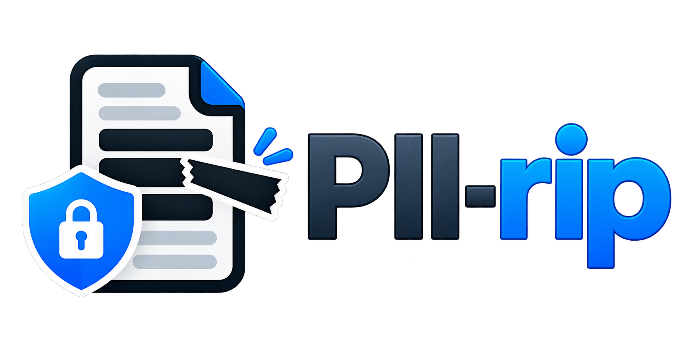

[](https://www.codefactor.io/repository/github/edonosotti/piirip-doc-anonymizer)
[](https://app.codacy.com/gh/edonosotti/piirip-doc-anonymizer/dashboard?utm_source=gh&utm_medium=referral&utm_content=&utm_campaign=Badge_grade)
[](https://sonarcloud.io/summary/new_code?id=edonosotti_piirip-doc-anonymizer)
[](https://sonarcloud.io/summary/new_code?id=edonosotti_piirip-doc-anonymizer)
[](https://sonarcloud.io/summary/new_code?id=edonosotti_piirip-doc-anonymizer)
[](https://sonarcloud.io/summary/new_code?id=edonosotti_piirip-doc-anonymizer)
[](https://sonarcloud.io/summary/new_code?id=edonosotti_piirip-doc-anonymizer)

# PII-rip - Document Anonymizer

Command-line tool that redacts Personally Identifiable Information (PII) from
documents using [Presidio](https://github.com/data-privacy-stack/presidio).

Supported file formats: `DOCX`, `PDF`, `TXT`, `ODT`, `XLSX`, `MD`, `HTML`, `CSV`.

Check the [Presidio Entities](https://presidio.dataprivacystack.org/supported_entities/)
for more details on the types of data that can be redacted.

## Disclaimer

Redaction is not foolproof. Always review the output to ensure that all sensitive
information has been properly removed. The tool relies on Presidio's recognizers
and may miss some PII, especially in complex or unstructured documents.
This software is provided without any warranties, express or implied, including
but not limited to the implied warranties of merchantability and fitness for a
particular purpose. Use at your own risk.

## Install

```bash
pip install -e .
python -m spacy download en_core_web_lg
```

For reproducible installs, use the committed lock file (`uv.lock`):

```bash
uv sync --extra dev    # installs the exact locked versions
uv lock --upgrade      # refresh the lock file when updating dependencies
```

## Usage

```bash
piirip [options] FILE [FILE ...]
```

Each input is processed independently. By default the result is written next to
the original as `NAME.redacted.EXT`; the original is never modified unless you
pass `--in-place`. The tool prints one line per file with the number of
redactions, and exits with a non-zero status if any file was skipped or failed
(unsupported extension, missing file, processing error).

### Examples

```bash
# 1. Default playbook: creates report.redacted.docx and notes.redacted.txt
piirip report.docx notes.txt

# 2. Redact everything Presidio can detect (more thorough, more false positives)
piirip -p all data.xlsx

# 3. Custom playbook, results collected in out/ (created if missing)
piirip -p my_playbook.yaml -o out/ *.pdf

# 4. Overwrite the original files (make a backup first!)
piirip --in-place contract.docx

# 5. Only keep high-confidence matches, and hide the entity type
piirip -t 0.6 --generic letter.md # "Use <REDACTED>" instead of "Call <PHONE_NUMBER>"

# 6. PDF with text placeholders instead of black boxes
piirip --pdf-style placeholder contract.pdf

# 7. Italian document with an Italian spaCy model
python -m spacy download it_core_news_lg
piirip -l it -m it_core_news_lg documento.odt

# 8. Show which entities a playbook will look for, then exit
piirip --list-entities
piirip --list-entities -p my_playbook.yaml
```

### Options

|            Option               |                                                                              Description                                                                                                          |
| ------------------------------- | ------------------------------------------------------------------------------------------------------------------------------------------------------------------------------------------------- |
| `FILE ...`                      | One or more documents. Supported extensions: `.docx .pdf .txt .odt .xlsx .md .markdown .html .htm .csv`.                                                                                          |
| `-p, --playbook NAME_OR_PATH`   | Which entities to redact. `default` (the default), `all`, or the path to a YAML playbook. See [Playbooks](#playbooks).                                                                            |
| `-o, --output-dir DIR`          | Write outputs to `DIR` (created if needed) instead of next to the input. Files are still named `NAME.redacted.EXT`. Ignored with `--in-place`.                                                    |
| `--in-place`                    | Overwrite each input file with its redacted version (written to a temp file first, so a failure does not corrupt the original).                                                                   |
| `-l, --language CODE`           | Language of the documents (default `en`). Must match the spaCy model; it drives name/location detection and which recognizers are active.                                                         |
| `-m, --model NAME`              | spaCy model used for NER (default `en_core_web_lg`). Must be installed, e.g. `python -m spacy download NAME`.                                                                                     |
| `-t, --threshold SCORE`         | Minimum Presidio confidence, 0.0-1.0 (default `0.35`, or the playbook's `score_threshold`). Higher = fewer false positives but more missed PII; lower = the opposite.                             |
| `--generic`                     | Replace matches with `<REDACTED>` instead of `<ENTITY_TYPE>`, so the kind of data removed is not revealed.                                                                                        |
| `--pdf-style {box,placeholder}` | PDF only. `box` (default) paints a black box over removed text; `placeholder` replaces it with placeholders (`<PERSON>`, or `<REDACTED>` with `--generic`). Original text is permanently removed. |
| `--list-entities`               | Print the entities of the selected playbook (one per line) and exit; no files needed.                                                                                                             |
| `--version`, `-h`               | Show version / help.                                                                                                                                                                              |

## Desktop app (GUI)

A simple desktop app is also available: drag and drop a document onto the window
(or click it to pick a file), wait for the redaction to finish, then choose where
to save the redacted copy. It uses the `default` playbook and English model.

```bash
pip install -e .[gui]
piirip-gui
```

### Standalone executables

Executables for Windows, macOS and Linux are built by the
[Build GUI executables](.github/workflows/build-gui.yml) GitHub Actions workflow
(run it manually or push a `v*` tag, then download the artifacts). To build one
for your current OS:

```bash
pip install -e .[build]
python -m spacy download en_core_web_lg
./packaging/build.sh # output in dist/PII-rip/
```

The bundle includes the spaCy model, so it is large (~1 GB uncompressed). The
executables are unsigned: Windows SmartScreen and macOS Gatekeeper will warn on
first launch.

## Playbooks

- `default`: common entities (see [src/piirip/data/default.yaml](src/piirip/data/default.yaml))
- `all`: all entities supported by the installed Presidio version
- a custom `YAML` file:

```yaml
entities: [PERSON, EMAIL_ADDRESS, PHONE_NUMBER]
score_threshold: 0.4 # optional
```

## How complex document formats are handled and redacted

- `DOCX`: body, tables, headers, footers, comments, footnotes and tracked
  deletions. PII split across formatting runs is still caught; identity metadata
  is cleared and other XML text and metadata are redacted.
- `XLSX`: string cells (including hidden sheets), comments, hyperlinks and
  package metadata. Formulas are left untouched.
- `ODT`: paragraphs, headers/footers, comments and package metadata.
- `HTML`: text nodes plus alt, title, href, value and similar attributes. HTML comments are removed.
- `CSV`: text in each field is redacted independently; rows and columns are preserved.
- `PDF`: matched page text is by default permanently removed (black boxes, not just
  covered). Annotation comments, form fields, links and bookmarks are also redacted;
  document metadata is cleared. Placeholders can be used in place of black boxes;
  see Usage above. Scanned PDFs would need OCR first, which isn't included.

Identity fields in office-package XML and DOCX/XLSX/PDF author metadata are cleared.
Binary embedded objects and files are not inspected.
Country-specific recognizers (in `all`) are applied to the chosen `--language`.

## Tests

`pip install -e .[dev] && pytest`
